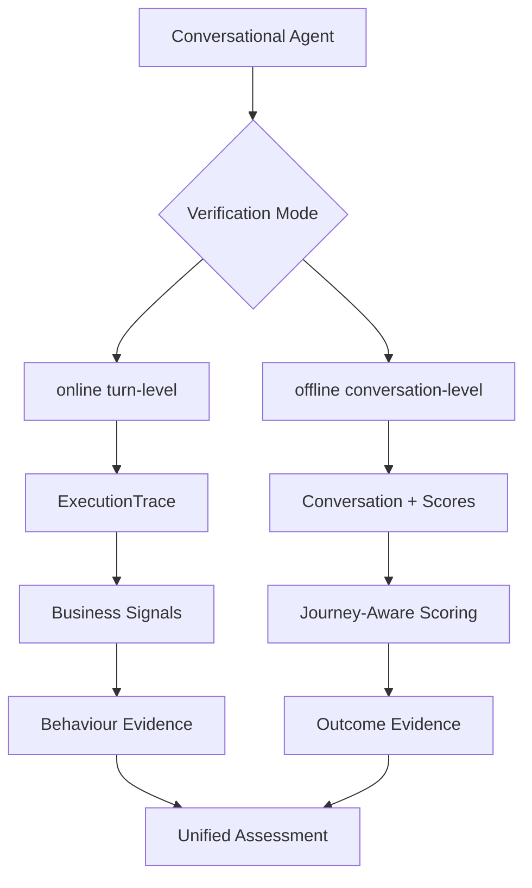

# Architecture Review: As-Built Technical Reference

Scope: [src/workshop_verify_agents](src/workshop_verify_agents)

This document is the single technical architecture reference for runtime and verification implementation.

## Runtime And Verification Statement

Online CLI flow is behaviour-only.
Offline verifier provides conversation-level unified behaviour and outcome assessment.

## Canonical Architecture Diagram

## Runtime Flow

### Online turn-level flow

1. Runtime executes one turn through synthetic or ADK mode.
2. One ExecutionTrace is produced for that turn.
3. Business signals are extracted from the trace.
4. Applicable control policies are verified against observed response metadata.
5. Behaviour and policy evidence are built.
6. Unified assessment policy is applied to behaviour evidence for turn-level assessment.

Key modules:

- [src/workshop_verify_agents/app.py](src/workshop_verify_agents/app.py)
- [src/workshop_verify_agents/adk_runtime/runner.py](src/workshop_verify_agents/adk_runtime/runner.py)
- [src/workshop_verify_agents/verification/online_verifier.py](src/workshop_verify_agents/verification/online_verifier.py)
- [src/workshop_verify_agents/verification/policy_verifier.py](src/workshop_verify_agents/verification/policy_verifier.py)

### Offline conversation-level flow

1. Per-turn behaviour verification results are collected.
2. Behaviour evidence is aggregated for the conversation.
3. Journey-aware scoring produces outcome evidence from conversation turns and scores.
4. Unified assessment policy combines behaviour and outcome evidence.

Key modules:

- [src/workshop_verify_agents/verification/offline_verifier.py](src/workshop_verify_agents/verification/offline_verifier.py)
- [src/workshop_verify_agents/verification/journey_outcome_adapter.py](src/workshop_verify_agents/verification/journey_outcome_adapter.py)
- [src/workshop_verify_agents/journey/journey_weighted_scorer.py](src/workshop_verify_agents/journey/journey_weighted_scorer.py)

## Module Responsibility Mapping

### adk_runtime

- Purpose: ADK session lifecycle, turn execution, raw event capture, trace normalization.
- Core files: [src/workshop_verify_agents/adk_runtime/runner.py](src/workshop_verify_agents/adk_runtime/runner.py), [src/workshop_verify_agents/adk_runtime/adk_trace_adapter.py](src/workshop_verify_agents/adk_runtime/adk_trace_adapter.py), [src/workshop_verify_agents/adk_runtime/root_agent.py](src/workshop_verify_agents/adk_runtime/root_agent.py)

### verification

- Purpose: schemas, signal extraction, evidence building, assessment policy, online/offline verifier orchestration.
- Core files: [src/workshop_verify_agents/verification/trace_schema.py](src/workshop_verify_agents/verification/trace_schema.py), [src/workshop_verify_agents/verification/signal_extractor.py](src/workshop_verify_agents/verification/signal_extractor.py), [src/workshop_verify_agents/verification/evidence_builder.py](src/workshop_verify_agents/verification/evidence_builder.py), [src/workshop_verify_agents/verification/verification_assessor.py](src/workshop_verify_agents/verification/verification_assessor.py), [src/workshop_verify_agents/verification/online_verifier.py](src/workshop_verify_agents/verification/online_verifier.py), [src/workshop_verify_agents/verification/offline_verifier.py](src/workshop_verify_agents/verification/offline_verifier.py)

### journey

- Purpose: journey taxonomy, stage classification, weighted outcome interpretation.
- Core files: [src/workshop_verify_agents/journey/journey_taxonomy.py](src/workshop_verify_agents/journey/journey_taxonomy.py), [src/workshop_verify_agents/journey/journey_classifier.py](src/workshop_verify_agents/journey/journey_classifier.py), [src/workshop_verify_agents/journey/journey_weighted_scorer.py](src/workshop_verify_agents/journey/journey_weighted_scorer.py)

### examples and notebooks

- Purpose: deterministic scenario assets and reproducible demonstrations.
- Core files: [src/workshop_verify_agents/examples/conversations.py](src/workshop_verify_agents/examples/conversations.py), [src/workshop_verify_agents/notebooks/01_trace_to_signal_demo.ipynb](src/workshop_verify_agents/notebooks/01_trace_to_signal_demo.ipynb), [src/workshop_verify_agents/notebooks/02_journey_aware_verification_demo.ipynb](src/workshop_verify_agents/notebooks/02_journey_aware_verification_demo.ipynb)

## Dependency Boundaries

- Runtime modules produce traces and do not own verification policy logic.
- verification modules own signal, policy, evidence, and assessment contracts.
- journey modules own stage-aware outcome interpretation and do not execute runtime orchestration.
- offline_verifier is the integration seam for conversation-level behaviour and outcome evidence.

## Implementation Status

- Online turn-level behaviour and policy verification: implemented and active.
- Offline conversation-level unified behaviour and outcome assessment: implemented and active.
- ADK session reuse through conversation_id/session_id mapping: implemented.
- Deterministic synthetic scenario and notebook demonstrations: implemented.

## Risks And Gaps

- Scenario evaluation remains synthetic and uses mocked turn-level quality scores.
- Outcome evidence provenance is reviewable but can be further structured.
- Config artifacts exist, but some policy behavior remains code-defined rather than config-driven.
